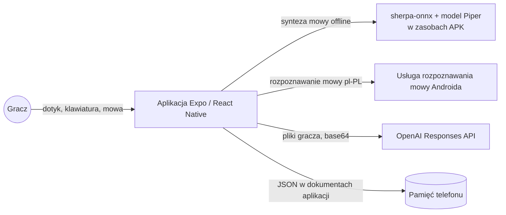
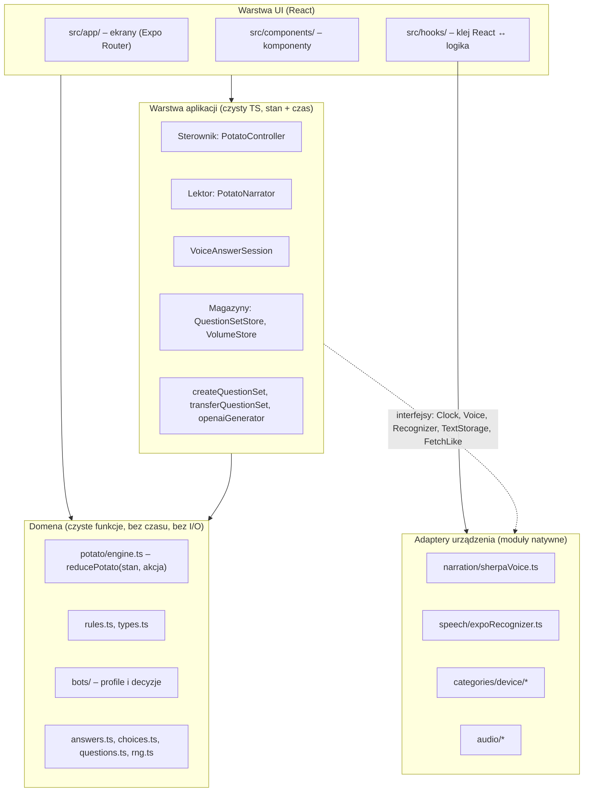
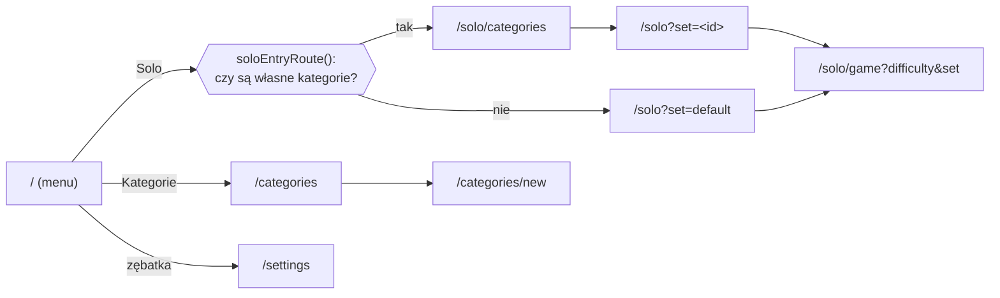
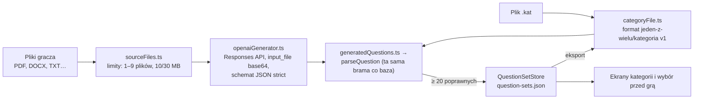

# Jeden z Wielu – architektura aplikacji

Dokument dla architekta projektu. Opisuje, z czego składa się aplikacja, jak płyną dane, jakie zasady obowiązują w kodzie i gdzie są znane luki. Stan na 03.11.2026, po usunięciu klasycznego silnika „1 z 10”.

Powiązane dokumenty:
- `docs/Dokumentacja_postepow_prac.md` – co i kiedy zrobiono, zasady gry, problemy,
- `docs/zabezpieczenia/` – ryzyka i zabezpieczenia każdej funkcjonalności (jeden plik na funkcję),
- `CLAUDE.md`, `AGENTS.md` – wymagany sposób pracy i polecenia.

---

## 1. Kontekst systemu

Gra quizowa na Androida (orientacja pozioma) w stylu teleturnieju. Gracz gra z 4 botami. Prowadzący mówi polskim głosem syntezowanym **na telefonie**. Gracz może odpowiadać dotykiem (A–D), pisemnie albo głosem. Własne kategorie pytań powstają z plików gracza przez OpenAI albo z importu pliku `.kat`.



Własny backend jest na etapie szkieletu: `server/` (Node + TypeScript, `/health` i WebSocket `/ws`) wdrażany jako kontener na **Azure Container Apps** (Azure for Students), instrukcja w `docs/backend-azure-instrukcja.md`. Aplikacja na razie tylko sprawdza z nim połączenie (Ustawienia → „Sprawdź połączenie”, adres z `EXPO_PUBLIC_SERVER_URL`). OpenAI dalej jest wywoływane z telefonu kluczem gracza (albo programisty z `.env.local`). Plan dla serwera: pośrednik OpenAI, baza pytań, Eliminacje, konta i autorytatywny multiplayer.

## 2. Stos technologiczny

| Warstwa | Technologia |
|---|---|
| Platforma | Expo SDK 57, React Native 0.86, React 19.2, nowa architektura RN, React Compiler |
| Język | TypeScript (strict), aliasy `@/*` → `src/*`, `@/assets/*` → `assets/*` |
| Nawigacja | Expo Router (pliki w `src/app/`, typowane trasy) |
| Grafika | `react-native-svg` (tło i kształty rysowane w kodzie), Reanimated |
| Dźwięk | `expo-audio` (muzyka, odtwarzanie syntezy) |
| Synteza mowy | `react-native-sherpa-onnx` + model Piper (VITS, 22 050 Hz) – moduł natywny |
| Rozpoznawanie mowy | `expo-speech-recognition` (`pl-PL`) – moduł natywny |
| Pliki | `expo-document-picker`, `expo-file-system`, `@dr.pogodin/react-native-fs` |
| Sekrety | zmienna `EXPO_PUBLIC_OPENAI_API_KEY` z `.env.local` (trafia do paczki jawnym tekstem) |
| AI | OpenAI Responses API, Structured Outputs (`strict: true`) |
| Testy | Jest + `jest-expo`, fałszywe zegary Jesta |
| Budowanie | EAS Build (`eas.json`: development / preview / production), CNG – `android/` generowany |
| Narzędzia offline | Python (`scripts/narration/`) – tylko przygotowanie modelu głosu |

Moduły natywne (sherpa-onnx, rozpoznawanie mowy) nie działają w Expo Go. Gra działa tam dalej, ale bez głosu i bez mikrofonu. Pełna aplikacja wymaga development builda albo APK.

## 3. Warstwy i zasada zależności

Najważniejsza decyzja architektoniczna: **logika gry jest czystym TypeScriptem niezależnym od React Native**, a wszystko, co dotyka telefonu, jest za interfejsem wstrzykiwanym z zewnątrz. Dzięki temu prawie cała gra jest testowalna w Jest bez emulatora.



Reguły:
1. **Domena** (`src/game/` bez `potato/controller/`) nie zna czasu, React, logów ani urządzenia. `reducePotato` jest czystą funkcją: zwraca nowy stan, nie modyfikuje starego, nie loguje. Losowość przychodzi z zewnątrz (gotowe decyzje w akcji, a tasowanie talii przez `Rng` z ziarnem przy tworzeniu gry).
2. **Warstwa aplikacji** dokłada czas i reżyserię. Zależności od świata przychodzą przez interfejsy: `Clock`, `Voice`, `Recognizer`, `TextStorage`, `FetchLike`. W testach podstawiane są atrapy z folderów `testing/`.
3. **Adaptery urządzenia** są cienkie i jako jedyne importują moduły natywne. Tworzone są w hookach albo w plikach-singletonach (`questionSets.ts`, `volume.ts`).
4. **UI** tylko wyświetla „widok” sterownika i przekazuje mu ruchy gracza. Nie zawiera reguł gry.

## 4. Struktura katalogów

```
src/
  app/                    ekrany (każdy plik = trasa)
    _layout.tsx           Stack bez nagłówków; wczytuje głośność na starcie
    index.tsx             menu główne (Solo, MultiPlayer, Dodatki, Kategorie, zębatka)
    settings.tsx          klucz API OpenAI, suwaki głośności
    categories/index.tsx  lista kategorii, import/eksport .kat, usuwanie
    categories/new.tsx    nowa kategoria z plików przez OpenAI
    solo/categories.tsx   wybór kategorii przed grą (gdy jest więcej niż domyślna)
    solo/index.tsx        wybór poziomu trudności
    solo/game.tsx         rozgrywka
  components/             home/, solo/, potato/, categories/, settings/
  hooks/                  usePotatoController,
                          useVoiceAnswer, useQuestionSets, useMenuMusic, useKeyboardHeight
  game/                   domena + sterowniki
    types.ts rules.ts clock.ts answers.ts choices.ts questions.ts rng.ts
    bots/                 profiles.ts (8 postaci), brain.ts (decyzje)
    potato/               engine.ts, solo.ts, bots.ts, texts.ts, controller/PotatoController.ts
    testing/              wspólne fikstury testów
  narration/              voice (interfejs), PotatoNarrator, sherpaVoice, pronunciation,
                          questionIntonation, modelAsset; testing/FakeVoice
  speech/                 VoiceAnswerSession, spokenAnswer, expoRecognizer; testing/FakeRecognizer
  categories/             QuestionSetStore, createQuestionSet, openaiGenerator, generatedQuestions,
                          categoryFile, transferQuestionSet, sourceFiles, errors, types; device/
  settings/               VolumeStore, configApiKey
  audio/                  menuMusic, menuMusicRoutes, gameMusic, volume (czysta funkcja wzmocnienia)
  lib/log.ts              logowanie
  data/questions.json     domyślna baza pytań (wersja 2, 50 pytań)
  constants/theme.ts      kolory
server/                   serwer gry (osobny pakiet npm, Docker → Azure Container Apps); poza tsc/jest/lint aplikacji
src/backend/              checkServer (połączenie z serwerem), adres serwera z .env.local
plugins/withVoiceModel.js wtyczka konfiguracyjna: kopiuje model głosu do zasobów Androida
scripts/narration/        przygotowanie modelu Piper dla sherpa-onnx (Python)
voiceModel/               voice.onnx (źródło); vits-piper-pl/ generowany, w .gitignore
.githooks/pre-commit      blokada commitu kluczy API i plików .env
```

## 5. Nawigacja



Parametry przechodzą przez URL (`difficulty`, `set`). Stan współdzielony między ekranami (kategorie, głośność) jest w singletonach-magazynach czytanych przez `useSyncExternalStore`, a nie w kontekście React. „MultiPlayer” i „Dodatki” nie mają jeszcze ekranów.

## 6. Domena gry

### 6.1. Silnik

Zasady „Gorącego Ziemniaka” (PDF „Quiz Frenzy”) to czysty `stan + akcja → nowy stan`.

| | |
|---|---|
| Silnik | `game/potato/engine.ts` – `createPotatoGame`, `reducePotato` |
| Fazy | `round1` (ziemniak, 3 życia) → `round2` (bomba z mnożnikiem, osłona) → `sprint` (60 s) → `duel` (finał) → `finished` |
| Akcje | `start`, `answer` (z polem `next`), `blindPass`, `tick`, `endEarly` (odpadł człowiek) |
| Losowość | w silniku żadnej – decyzje losowe podaje sterownik w akcji; talię tasuje `createPotatoSoloGame` |
| Stan oczekiwania | `holderId` + `question` |
| Sterownik | `PotatoController` |
| Lektor | `PotatoNarrator` + `potato/texts.ts` |
| Ekran | `components/potato/PotatoGame.tsx` (trasa `solo/game.tsx`) |

Komponenty `Podium`, `QuestionCard`, `AnswerPanel`, `Host`, `TimerBar` są w `components/solo/`; `PotatoGame` mapuje swojego gracza na `PlayerState` (`toPodium`). Klasyczny silnik „1 z 10” został usunięty 03.11.2026; jego kod jest w historii gita.

### 6.2. Parametry

Zasady są w stałej `POTATO` w `potato/engine.ts`. Poziomy trudności (`DIFFICULTY_PRESETS` w `game/rules.ts`) zmieniają wiedzę i szybkość botów, format odpowiedzi gracza (`choice` dla Łatwy/Normalny, `text` dla Ekspert) i czas na odpowiedź.

### 6.3. Pytania i odpowiedzi

- **Format:** `Question { id, category, question, answers[], answerType, wrongAnswers?, difficulty }`. `answers[0]` jest pokazywana graczowi. `category` to dziedzina (Historia, Sport…), **nie** kategoria z menu – ta w kodzie nazywa się `QuestionSet`.
- **Walidacja:** `parseQuestion` / `parseQuestionBank` (`questions.ts`). Ta sama funkcja sprawdza bazę domyślną przy starcie, pytania z OpenAI i pytania z importu `.kat`. To jedna brama wejściowa dla danych.
- **Sprawdzanie:** `isCorrectAnswer` (`answers.ts`) – normalizacja (małe litery, bez polskich znaków i interpunkcji) + odległość Levenshteina z limitem zależnym od długości (0/1/2 literówki, 0 dla liczb).
- **Opcje A–D:** `buildChoices` (`choices.ts`) – poprawna + pomyłki z `wrongAnswers`, liczby obok poprawnej albo odpowiedzi z innych pytań tego samego typu.
- **Odpowiedź głosowa:** `chooseSpokenAnswer` (`speech/spokenAnswer.ts`) – wybiera z kilku transkrypcji pierwszą poprawną albo najbardziej prawdopodobną, cofa liczebniki („Mieszko pierwszy” → „Mieszko I”).

### 6.4. Boty

`bots/profiles.ts` – 8 postaci z płcią (pula skórek), wiedzą bazową i mocnymi/słabymi dziedzinami. `bots/brain.ts` – czyste decyzje: szansa trafienia (`correctChance`), pomyłka tego samego typu (`wrongAnswer`), odpowiedź i jej opóźnienie (`decideAnswer`). `potato/bots.ts` – wybór celu (`pickTarget`: lider 60%, najsłabszy 40%). Boty nie są w silniku; wywołuje je sterownik.

## 7. Sterownik (czas rzeczywisty)

`PotatoController` to obiekt z zewnętrznym magazynem stanu („widokiem”), zgodny z `useSyncExternalStore`:

```
subscribe(listener) / getView()   → React renderuje widok
start() / stop()                  → cykl życia ekranu
pause() / unpause()               → okno „Przerwać grę?”
submitAnswer(text) / pick(id)     → ruchy gracza
blindPass(id)                     → „odbicie w ciemno”
setSpeaking(bool)                 → lektor zgłasza początek/koniec mowy
```

`PotatoView` zawiera stan silnika i stan reżyserii: `overlay` (wynik, plansza rundy, koniec gry), `deadline`/`timerMs`, `thinkingId` (który bot „myśli”), `awaitingPick`, `choices` (A–D), `sprintEndsAt`, `paused`, `speaking`.

Zasady sterownika:
- **Wstrzykiwany zegar** (`Clock` z `game/clock.ts`; produkcyjnie `realClock`). Testy używają fałszywych zegarów.
- **Wszystkie zmiany stanu gry idą przez `reducePotato`.** Sterownik tylko decyduje, *kiedy* i *jaką* akcję wysłać.
- **Pauza zachowuje pozostały czas** kroku i sprintu (`freezeMain`, `MainStep.armedAt`).
- **Czekanie na lektora:** kroki startują dopiero po ciszy (`whenReady`). Każdy nowy krok najpierw kasuje poprzedni pasek (`clearMain`), więc w czasie mówienia pasek nie biegnie.

Hook `usePotatoController` tworzy grę z ziarnem `Date.now()` (logowanym, żeby odtworzyć błąd), sterownik i lektora; przy odmontowaniu zatrzymuje zegary i zwalnia odtwarzacz.

## 8. Lektor (synteza mowy na żywo)

```mermaid
sequenceDiagram
    participant C as Sterownik
    participant N as PotatoNarrator
    participant V as sherpaVoice (Voice)
    participant S as sherpa-onnx (natywny)
    participant A as expo-audio
    C->>N: zmiana widoku (subscribe)
    N->>N: nowa kwestia? (bez powtórzeń)
    N->>C: setSpeaking(true)
    N->>V: say([zdania])
    loop każde zdanie
        V->>S: synteza (model w pamięci)
        V->>V: riseQuestionEnding() dla "?"
        V->>A: odtwórz; w tym czasie synteza następnego
    end
    V-->>N: koniec
    N->>C: setSpeaking(false)
```

- Teksty prowadzącego: `narrationFor` w `PotatoNarrator.ts` i `potato/texts.ts`.
- `Voice` (`narration/voice.ts`) to interfejs (`say`, `pause`, `resume`, `stop`, `dispose`). Implementacja `sherpaVoice.ts`, atrapa `testing/FakeVoice.ts`.
- `pronunciation.ts` – cyfry rzymskie po imieniu → liczebniki. `questionIntonation.ts` – sztuczne podniesienie tonu na końcu pytania (przyspieszenie ostatnich 450 ms).
- Muzyka gry cichnie, gdy lektor mówi (`setGameMusicDucked`).
- Głośność lektora pochodzi z `VolumeStore`.
- **Model głosu w buildzie:** `voiceModel/voice.onnx` → `scripts/narration/prepare_voice_model.py` → `voiceModel/vits-piper-pl/` (model + `tokens.txt` + `espeak-ng-data`) → `plugins/withVoiceModel.js` przy `npx expo prebuild` kopiuje go do zasobów Androida pod nazwą folderu ze skrótem SHA-1 zawartości (sherpa-onnx nie odświeża raz skopiowanego modelu). `modelAsset.ts` wybiera folder modelu, który naprawdę jest w APK (nazwa z konfiguracji Expo może nie pasować w development buildzie). Prebuild bez przygotowanego modelu kończy się błędem z instrukcją.

## 9. Odpowiadanie głosem

`AnswerPanel` → `useVoiceAnswer` → `VoiceAnswerSession` (czysta logika sesji: start, wyniki częściowe, koniec, błędy, komunikaty) → `Recognizer` (interfejs) → `expoRecognizer.ts` (`expo-speech-recognition`, `pl-PL`). Przycisk pojawia się tylko, gdy urządzenie ma rozpoznawanie. Zgoda na mikrofon – przy pierwszym użyciu. Cisza lub brak zgody nie kosztuje szansy. W trybie A–D mikrofon jest wyłączony.

## 10. Kategorie (własne zestawy pytań)



- `createQuestionSet.ts` – przebieg „z plików” (kroki `reading` → `generating` → `saving`), z wstrzykiwanymi zależnościami. Wszystko, co da się sprawdzić offline (nazwa, limit 3 kategorii, pliki, klucz), sprawdzane jest **przed** płatnym zapytaniem.
- `transferQuestionSet.ts` – import/eksport `.kat` z wstrzykiwanym odczytem i zapisem. Import przyjmuje tylko rozszerzenie `.kat`, do 5 MB; zajęta nazwa dostaje sufiks „(2)”.
- `QuestionSetStore` – jeden plik JSON z wersją (`STORAGE_VERSION`), zestaw „Domyślna” (wbudowany, nieusuwalny) + do 3 własnych. Udostępnia `subscribe`/`getSets` dla `useQuestionSets`.
- Błędy dla gracza – `CategoryError` (`errors.ts`) z polskimi komunikatami.
- `device/` – wybór plików, zapis przez systemowy wybór folderu (`Directory.pickDirectoryAsync`).

## 11. Ustawienia, sekrety, dźwięk

- **Klucz API:** tylko `EXPO_PUBLIC_OPENAI_API_KEY` z `.env.local`; `configApiKey.ts` sprawdza format, a zły klucz traktuje jak brak. Klucz trafia do APK jawnym tekstem, więc APK z kluczem nie wolno udostępniać. Build EAS nie widzi `.env.local` i potrzebuje zmiennych środowiskowych EAS. Hak `.githooks/pre-commit` (włączany skryptem `prepare`) blokuje commit plików `.env*` i tekstów wyglądających na klucz.
- **Głośność:** `VolumeStore` (muzyka i głos 0–100, plik `volume.json`), wczytywany w `_layout.tsx` przed pierwszym ekranem.
- **Muzyka:** `audio/menuMusic.ts` – jeden odtwarzacz dla wszystkich ekranów poza rozgrywką, włączany w `_layout.tsx` (`useMenuMusic`, wyjątki w `menuMusicRoutes.ts`), ze zwłoką pauzy 400 ms. `audio/gameMusic.ts` – muzyka rozgrywki, ciszej pod lektorem. Sterowanie tylko suwakiem w Ustawieniach. `volume.ts` – czysta funkcja `musicGain`.

## 12. Przekrojowe zasady

### 12.1. Logowanie
`createLogger('<moduł>')` z `src/lib/log.ts`. Poziomy `debug`/`info` dla zwykłego przebiegu, `warn`/`error` widać na ekranie w Expo Go. Logujemy tylko małe wartości (id, liczby), nigdy cały stan gry. Bufor wpisów i wymienne „sinki” pozwalają testom sprawdzać logi. Silnik nie loguje.

### 12.2. Wstrzykiwanie zależności
Każda klasa z efektami ubocznymi dostaje je w konstruktorze (zegar, głos, rozpoznawanie, magazyn, `fetch`, `now`). Produkcyjne instancje składane są w jednym miejscu: hooki gry oraz singletony `categories/questionSets.ts`, `settings/volume.ts`.

### 12.3. Odporność
Brak modułu natywnego (Expo Go) nie przerywa gry: lektor w `try/catch` przy tworzeniu, mikrofon ukryty. Błędne dane z sieci i plików są odrzucane pojedynczo przez wspólną walidację.

### 12.4. Testy
- Testy w folderach `__tests__` obok kodu (każdy plik tam jest testem), atrapy w `testing/`.
- Rodzaje: jednostkowe (silnik, boty, odpowiedzi, magazyny), testy sterownika na fałszywym zegarze, testy integracyjne (`*integration-test.ts` – te same moduły co aplikacja, tylko adaptery urządzenia podmienione), test wtyczki `withVoiceModel`.
- 521 testów aplikacji wg `npm test` (z parametryzacją), plus osobne testy `server/`.
- Przed zakończeniem pracy: `npm test`, `npx tsc --noEmit`, `npx expo lint`.

### 12.5. Proces dla nowej funkcji
1. `docs/zabezpieczenia/<funkcja>.md` przed kodem (ryzyko → zabezpieczenie → test).
2. Logi przez `createLogger`.
3. Testy jednostkowe i integracyjne.
4. Aktualizacja `docs/Dokumentacja_postepow_prac.md`.
5. `npm test`, `npx tsc --noEmit`, `npx expo lint`.

## 13. Znane luki i dług techniczny

Rzeczy znalezione przy przeglądzie kodu, do decyzji architekta:

1. **Zawieszony lektor blokuje grę.** Kroki czekają na `setSpeaking(false)` bez limitu czasu. Odrzucona obietnica jest obsłużona, ale obietnica, która nigdy się nie skończy, zatrzyma rozgrywkę. Limit 20 s był tylko w usuniętym sterowniku.
2. **Mikrofon nie ucisza lektora.** `PotatoGame` nie przekazuje `onListening` do `AnswerPanel`, a `PotatoController` nie ma `setListening`. Na poziomie Ekspert gracz może włączyć mikrofon w czasie czytania pytania i rozpoznawanie słyszy wtedy lektora. Tak samo było przed usunięciem starego silnika.
3. **„Gorący Ziemniak” nie ma pełnego opisu w `Dokumentacja_postepow_prac.md`** (rozdziały 3–5 opisują usunięte zasady; aktualne ryzyka są w `docs/zabezpieczenia/rundy-goracy-ziemniak.md`).
4. **Brak symulacji balansu.** Symulator działał tylko na starym silniku i został usunięty; nowych zasad nie sprawdzono na setkach gier pod kątem balansu.
5. **Klucz OpenAI w APK.** Klucz jest tylko w `.env.local` i trafia do paczki jawnym tekstem, więc gra z kategoriami z plików nie nadaje się do rozdawania. Build EAS bez zmiennych środowiskowych nie ma klucza wcale. Docelowo pośrednik po stronie serwera.
6. **Backend tylko jako szkielet, brak multiplayera.** Serwer testowy (`server/`) działa, ale nie ma jeszcze żadnej logiki gry. Silniki są deterministyczne i oparte na akcjach, co dobrze pasuje do multiplayera z autorytatywnym serwerem (ten sam `reduce` po stronie serwera), ale nic z tego jeszcze nie istnieje.
7. **Rozmiar modelu głosu** (63 MB) w APK. Rozważana kwantyzacja int8; AAB dla Google Play.
8. **Brak testów komponentów** (np. React Native Testing Library) – UI sprawdzany ręcznie.
9. **Martwy skrypt:** `reset-project` w `package.json` wskazuje nieistniejący `scripts/reset-project.js`.
10. **Mała baza pytań:** 50 pytań wobec docelowych ~2000.

## 14. Kierunki rozwoju (z perspektywy architektury)

- **Multiplayer:** przenieść czysty silnik do wspólnego pakietu, serwer wykonuje `reduce`, klient wysyła akcje i odbiera widok. Sterownik klienta zostaje warstwą reżyserii (czas, lektor), ale bez decyzji o stanie.
- **Pośrednik AI:** `openaiGenerator` ma już wstrzykiwany `FetchLike` i adres – wystarczy podmienić cel na własny endpoint.
- **Baza pytań:** przy ~2000 pytań rozważyć ładowanie z serwera lub z pliku per dziedzina zamiast jednego JSON w bundlu; walidacja `parseQuestion` zostaje bramą.
