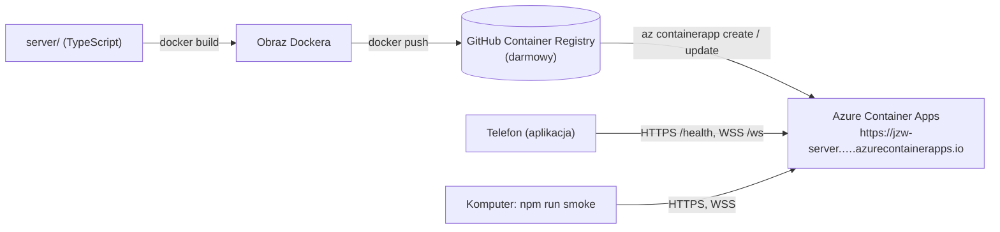

# Serwer gry na Azure – instrukcja krok po kroku

Instrukcja stawia **testowy serwer** z katalogu `server/` na Azure i sprawdza, czy łączy się z nim komputer i telefon. Serwer na razie umie tylko dwie rzeczy:

- `GET /health` → `{"status":"ok","version":"0.1.0","time":"…"}`,
- WebSocket `/ws` → na powitanie `{"type":"hello"}`, na `{"type":"ping","id":1}` odpowiada `{"type":"pong","id":1,"serverTime":…}`.

Na tym samym szkielecie powstaną później pośrednik OpenAI, baza pytań, Eliminacje i multiplayer.

## Kontener czy maszyna wirtualna?

**Kontener w Azure Container Apps, bez VM.** Przebieg wygląda tak:



| | Container Apps | Maszyna wirtualna |
|---|---|---|
| Koszt, gdy nikt nie gra | ~0 (skaluje do zera) | płacimy całą dobę |
| HTTPS, certyfikat, domena | dostajemy od razu | sami: nginx, Let's Encrypt |
| Aktualizacje systemu, firewall | robi Azure | robimy sami |
| WebSockety (multiplayer) | tak | tak |
| Wdrożenie nowej wersji | jedno polecenie | SSH, kopiowanie, restart |

Maszyna wirtualna nie łączy się z kontenerem. Kontener sam jest „serwerem”, a Azure uruchamia go na swoich maszynach.

---

## 0. Co trzeba mieć

- Konto **Azure for Students**: https://azure.microsoft.com/free/students. Rejestracja mailem uczelnianym, bez karty. Dostajesz 100 USD na 12 miesięcy, odnawiane co rok w czasie studiów, jedno konto na osobę. Kredytu nie da się wydać na Azure Marketplace.
- **Docker Desktop** (uruchomiony – ikona wieloryba w pasku menu).
- **Node 20+** i konto **GitHub** (na obraz w GHCR).
- **Azure CLI**:
  ```bash
  brew install azure-cli          # macOS; Windows: winget install -e --id Microsoft.AzureCLI
  az version
  ```

> Kto w zespole zakłada subskrypcję? Jedna osoba. Pozostałych dodaje się w portalu: grupa zasobów `rg-jedenzwielu` → **Access control (IAM)** → **Add role assignment** → rola **Contributor** → mail osoby. Każdy loguje się potem własnym `az login`.

## 1. Logowanie i przygotowanie subskrypcji

```bash
az login                                   # otwiera przeglądarkę
az account show --query "{nazwa:name, id:id}" -o table   # powinno być "Azure for Students"
az extension add --name containerapp --upgrade
az provider register --namespace Microsoft.App
az provider register --namespace Microsoft.OperationalInsights
az provider show --namespace Microsoft.App --query registrationState   # czekamy na "Registered" (1–2 min)
```

## 2. Pilnowanie kredytu (zrób to przed wdrożeniem)

Subskrypcja studencka ma **limit wydatków**. Po zużyciu kredytu Azure wyłącza zasoby, a nie obciąża karty (karty i tak nie ma). Wyłączony serwer w tygodniu prezentacji to też problem, dlatego:

1. Portal → **Cost Management** → **Budgets** → **Add**: zakres = subskrypcja, kwota np. 60 USD, alerty na 15%, 50%, 80% na maile zespołu. Jeśli dla tej subskrypcji budżety są niedostępne, sprawdzaj stan raz w tygodniu: portal → **Subscriptions** → *Azure for Students* → **Overview** (pozostały kredyt) albo https://www.microsoftazuresponsorships.com/balance.
2. Kontener stawiamy z `--min-replicas 0 --max-replicas 1 --cpu 0.25 --memory 0.5Gi` (krok 6). Darmowy miesięczny limit Container Apps (180 000 vCPU-s) przy 0,25 vCPU to ok. 200 godzin pracy kontenera, a kontener pracuje tylko wtedy, gdy ktoś jest połączony.
3. Obraz trzymamy w **GHCR** (darmowy), a nie w Azure Container Registry (Basic ≈ 5 USD/mies.).

## 3. Grupa zasobów

Wszystko, co tworzymy, trafia do jednej grupy, którą na koniec usuwa się jednym poleceniem.

```bash
RG=rg-jedenzwielu
LOCATION=westeurope
az group create --name $RG --location $LOCATION
```

Błąd `RequestDisallowedByPolicy` oznacza, że subskrypcja studencka nie pozwala na ten region. Komunikat wymienia dozwolone regiony. Wybierz któryś z nich (najbliżej Polski: `polandcentral`, `germanywestcentral`, `northeurope`, `swedencentral`) i powtórz polecenie.

## 4. Test lokalny (bez Azure)

```bash
cd server
npm ci
npm test                       # testy jednostkowe serwera
npm run dev                    # serwer na http://localhost:8080 z przeładowaniem po zmianie kodu
# w drugim terminalu:
npm run smoke -- http://localhost:8080
```

Oczekiwany wynik:

```
✓ GET /health – wersja dev, 20 ms
✓ WebSocket ws://localhost:8080/ws – powitanie od wersji dev
✓ ping 1 → pong w 1 ms
✓ ping 2 → pong w 0 ms
✓ ping 3 → pong w 0 ms
✓ Serwer działa
```

Teraz to samo w kontenerze, czyli dokładnie to, co uruchomi Azure:

```bash
docker build -t jzw-server .
docker run --rm -p 8080:8080 -e APP_VERSION=local jzw-server
npm run smoke -- http://localhost:8080       # w drugim terminalu; wersja powinna być "local"
```

## 5. Wysłanie obrazu do GitHub Container Registry

1. GitHub → **Settings** → **Developer settings** → **Personal access tokens (classic)** → **Generate new token** z zakresem `write:packages`. Skopiuj token.
2. Logowanie i wysyłka (`<github-login>` małymi literami):

```bash
GH_USER=<github-login>
VERSION=0.1.0
echo <TOKEN> | docker login ghcr.io -u $GH_USER --password-stdin

# Azure uruchamia kontenery na linux/amd64. Na Macu z procesorem M1–M4 bez --platform obraz nie wystartuje.
docker buildx build --platform linux/amd64 -t ghcr.io/$GH_USER/jzw-server:$VERSION --push .
```

3. GitHub → Twój profil → **Packages** → `jzw-server` → **Package settings** → **Change visibility** → **Public**. Obraz nie zawiera sekretów (patrz `server/.dockerignore`), więc może być publiczny. Wolisz prywatny? Wtedy w kroku 6 dodaj `--registry-server ghcr.io --registry-username $GH_USER --registry-password <token z read:packages>`.

> Wersję zawsze podawaj jawnie (`0.1.0`, `0.1.1`…), nie `latest`. Wtedy w `/health` od razu widać, czy działa nowy obraz.

## 6. Utworzenie kontenera na Azure

```bash
ENV_NAME=jzw-env
APP=jzw-server

# Środowisko Container Apps (raz). Tworzy też Log Analytics na logi – ma darmowe 5 GB miesięcznie.
az containerapp env create --name $ENV_NAME --resource-group $RG --location $LOCATION

# Sam kontener
az containerapp create \
  --name $APP \
  --resource-group $RG \
  --environment $ENV_NAME \
  --image ghcr.io/$GH_USER/jzw-server:$VERSION \
  --target-port 8080 \
  --ingress external \
  --min-replicas 0 \
  --max-replicas 1 \
  --cpu 0.25 --memory 0.5Gi \
  --env-vars APP_VERSION=$VERSION \
  --query properties.configuration.ingress.fqdn -o tsv
```

Ostatnie polecenie wypisuje adres, np. `jzw-server.kindwave-1234.westeurope.azurecontainerapps.io`. Zapisz go:

```bash
FQDN=$(az containerapp show -n $APP -g $RG --query properties.configuration.ingress.fqdn -o tsv)
echo https://$FQDN
```

> Alternatywa jednym poleceniem (bez Dockera na komputerze): `az containerapp up --name $APP --resource-group $RG --location $LOCATION --environment $ENV_NAME --source ./server --ingress external --target-port 8080`. Azure sam zbuduje obraz, ale założy do tego płatny Azure Container Registry (~5 USD/mies. z kredytu).

## 7. Testowe połączenie

**Z komputera:**

```bash
curl https://$FQDN/health
npm run smoke -- https://$FQDN          # z katalogu server/
```

Pierwsze zapytanie po przerwie może trwać 5–20 s, bo kontener „budzi się” z zera (zimny start). Kolejne odpowiadają od razu.

**Ręcznie przez WebSocket:**

```bash
npx wscat -c wss://$FQDN/ws
< {"type":"hello","version":"0.1.0"}
> {"type":"ping","id":1}
< {"type":"pong","id":1,"serverTime":1793707200000}
> zły tekst
< {"type":"error","reason":"invalid-json"}
```

**Z telefonu (aplikacja):**

1. W pliku `.env.local` w katalogu głównym projektu (wzór: `.env.example`):
   ```
   EXPO_PUBLIC_SERVER_URL=https://jzw-server.kindwave-1234.westeurope.azurecontainerapps.io
   ```
2. `npx expo start -c`, bo zmienne z `.env.local` wczytują się tylko przy starcie, a `-c` czyści cache Metro. Dla APK trzeba go zbudować od nowa.
3. W aplikacji: zębatka → **Ustawienia** → panel **Serwer gry** → **Sprawdź połączenie**. Powinno pojawić się „Połączono z serwerem w wersji 0.1.0 (… ms)”. W terminalu Expo widać log `[backend] Połączenie z serwerem działa`.

Działa to też w Expo Go, bo nie wymaga modułu natywnego.

## 8. Nowa wersja serwera

```bash
cd server
VERSION=0.1.1
npm test
docker buildx build --platform linux/amd64 -t ghcr.io/$GH_USER/jzw-server:$VERSION --push .
az containerapp update -n $APP -g $RG --image ghcr.io/$GH_USER/jzw-server:$VERSION --set-env-vars APP_VERSION=$VERSION
npm run smoke -- https://$FQDN                 # wersja powinna być 0.1.1
```

## 9. Logi i podgląd

```bash
az containerapp logs show -n $APP -g $RG --follow                 # logi serwera (JSON, tag "serwer")
az containerapp logs show -n $APP -g $RG --type system --follow   # start/stop kontenera, błędy pobierania obrazu
az containerapp replica list -n $APP -g $RG -o table              # czy kontener teraz działa (0 = uśpiony)
az containerapp show -n $APP -g $RG --query properties.template.scale   # minReplicas 0, maxReplicas 1
```

## 10. Prezentacja i sprzątanie

- Na czas prezentacji wyłącz zimny start, żeby pierwsze połączenie nie czekało: `az containerapp update -n $APP -g $RG --min-replicas 1`. **Po prezentacji wróć do `--min-replicas 0`**, bo kontener działający całą dobę zużywa kredyt.
- Koniec projektu albo „zacznijmy od nowa”: `az group delete --name $RG --yes`. To usuwa kontener, środowisko i logi i zatrzymuje wszystkie koszty. Obraz w GHCR zostaje.

## 11. Najczęstsze problemy

| Objaw | Przyczyna | Rozwiązanie |
|---|---|---|
| `RequestDisallowedByPolicy` przy tworzeniu | region niedozwolony dla subskrypcji studenckiej | inny `LOCATION` z listy w komunikacie |
| `exec format error` w `--type system` | obraz zbudowany na Macu M1–M4 bez `--platform linux/amd64` | zbuduj ponownie z `--platform linux/amd64` |
| `ImagePullBackOff` / `unauthorized` | prywatny pakiet w GHCR | ustaw pakiet jako publiczny albo dodaj `--registry-*` |
| `curl` czeka i kończy się timeoutem | zły `--target-port` (serwer słucha na 8080) | `az containerapp ingress update -n $APP -g $RG --target-port 8080` |
| Strona błędu Azure 404 | literówka w adresie albo kontener nie wystartował | sprawdź `FQDN` i logi `--type system` |
| Telefon: „Brak adresu serwera” | brak `EXPO_PUBLIC_SERVER_URL` albo Expo nie zostało zrestartowane | popraw `.env.local`, `npx expo start -c` |
| Telefon: „nie odpowiedział w 15 s” | zimny start | kliknij ponownie po kilku sekundach |
| `MissingSubscriptionRegistration` | nie zarejestrowano providera | krok 1: `az provider register …` |

## Pliki

| Plik | Co robi |
|---|---|
| `server/src/app.ts` | serwer HTTP + WebSocket (`createApp`) |
| `server/src/main.ts` | start na `PORT`, łagodne zamknięcie na `SIGTERM` |
| `server/src/log.ts` | logi JSON (do Log Analytics) |
| `server/scripts/smoke.ts` | test działającego serwera (`npm run smoke -- <adres>`) |
| `server/Dockerfile`, `server/.dockerignore` | obraz kontenera |
| `src/backend/serverHealth.ts` | `checkServer` – sprawdzanie połączenia z aplikacji |
| `src/backend/serverUrl.ts` | adres serwera z `.env.local` |
| `docs/zabezpieczenia/serwer-testowy.md` | ryzyka i zabezpieczenia |
